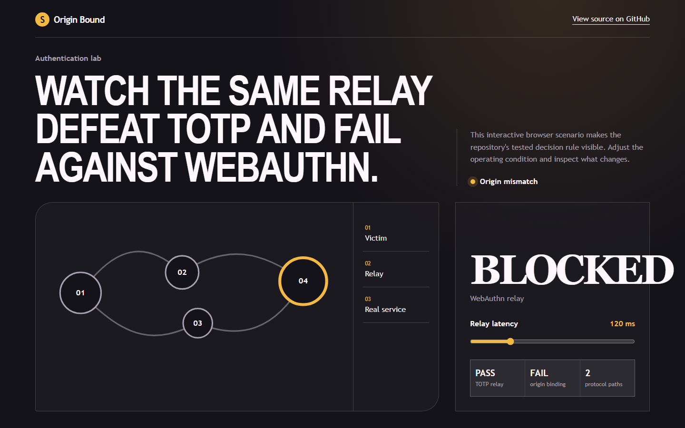
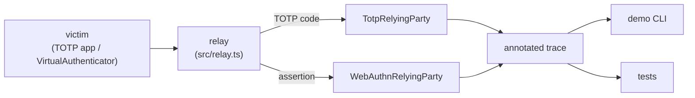

# originbound

A contained lab that runs the same real-time relay against TOTP and WebAuthn, shows it succeed against one and fail against the other, and names the protocol field that makes the difference.

[](https://github.com/SlateGitOrg/originbound/actions/workflows/ci.yml)
[Live demo](https://slategitorg.github.io/originbound/)



## Why

Teams roll out MFA and are still phished: a TOTP code or push approval is valid wherever it is presented, so an attacker-in-the-middle can forward it to the real site in real time. WebAuthn is phishing-resistant for a specific reason: the signed assertion includes `clientDataJSON.origin`, the origin the browser was actually on. Most demos show a passkey working and never show why that differs from the MFA you already have. This repo shows it, side by side, with a control run to prove the verifier is not simply rejecting everything.

## Features

- Two relying parties (TOTP, WebAuthn) and a virtual authenticator, all in-process.
- A relay run against each factor, producing a step-by-step trace and the deciding field.
- A control ceremony with no relay, so "rejected" is meaningful.
- Origin matching that treats `bank.example.evil` as a different site from `bank.example`.
- Challenge single-use, signature tampering and signature-counter (cloned authenticator) checks.
- A browser lab (`site/`) for exploring method, origin and rpId, deployed to GitHub Pages.

## Architecture



`src/lab.ts` defines the authenticators and relying parties, `src/relay.ts` runs the attack against each and returns a `RelayOutcome`, and `src/demo.ts` prints the comparison. Nothing touches a network; the "relay" is a function that passes values between objects. See [docs/ARCHITECTURE.md](docs/ARCHITECTURE.md).

## Quick start

Prerequisites: Node 22.18 or newer (24 recommended). TypeScript runs through Node's built-in type stripping, so there is no build step and no `npm install`.

```bash
git clone https://github.com/SlateGitOrg/originbound.git
cd originbound
npm run demo   # side-by-side relay comparison
npm test       # 20 tests in tests/ plus the site logic tests
```

## Example

`npm run demo` (trimmed; credential ids and challenges are random):

```text
ATTACK 1 - relay a TOTP code
    victim believes they are on https://bank.example.evil
    attacker forwards 595517 to https://bank.example
    https://bank.example ACCEPTS - the code is valid, and it carries no information about where it was typed
    RESULT: relay SUCCEEDED - the attacker is now logged in as the victim.

ATTACK 2 - the identical relay, against WebAuthn
    attacker relays that challenge to the victim on https://bank.example.evil
    the authenticator REFUSES to sign: the origin does not match the credential's rpId
    RESULT: relay FAILED (ORIGIN_MISMATCH)
    deciding field: clientDataJSON.origin (authenticator refused to sign)

CONTROL - the same WebAuthn ceremony with no relay
    RESULT: ACCEPTED - the control is not simply refusing everything.
```

## How it works

- **TOTP** derives a code from `(shared secret, time step)` with HMAC-SHA1 and dynamic truncation. `verify` has no parameter for an origin because the code does not commit to one. Replay protection stops reuse but not a relay, since the attacker submits first.
- **WebAuthn** assertions sign the authenticator data plus a hash of `clientDataJSON`, which carries the origin supplied by the browser. The relying party checks, in order: known credential, `origin` equals the expected origin, `rpIdHash`, single-use challenge, signature, then that the signature counter advanced.
- **Origin matching** is an exact host match or a true subdomain (`host === rpId || host.endsWith("." + rpId)`), https only. A bare `endsWith(rpId)` would accept `bank.example.evil`; a test pins that bug.
- The virtual authenticator signs with HMAC, so the relying party stores the same key material. A real deployment stores a public key; the origin check is unaffected.

## Testing

```bash
npm test
```

`tests/relay.test.ts` asserts that the relay succeeds against TOTP and fails with `ORIGIN_MISMATCH` against WebAuthn, that the control ceremony is accepted, that editing the origin after signing breaks the signature, that challenges cannot be replayed, that a rewound signature counter is flagged as `CLONED_AUTHENTICATOR`, and the origin-matching edge cases (lookalike domain, http, malformed input). `site/core.test.mjs` covers the browser lab's decision logic. CI runs both on Node 24.

## Project layout

```text
src/lab.ts        authenticators, relying parties, origin matching
src/relay.ts      the relay and the protocol comparison
src/demo.ts       CLI output
tests/            relay and origin-binding tests
site/             static browser lab (deployed to GitHub Pages)
scripts/          site validation used by CI
docs/             architecture notes and screenshots
```

## Limitations

- A model, not a WebAuthn implementation: no CBOR/COSE parsing, attestation verification or browser APIs, and signatures are HMAC rather than public-key.
- The browser lab models the origin-matching rule only; it does not run the full ceremony.
- No account recovery flow is implemented.
- Not an attack tool: the relay exists only inside the process, against a virtual authenticator.

## License

MIT — see [LICENSE](LICENSE).
