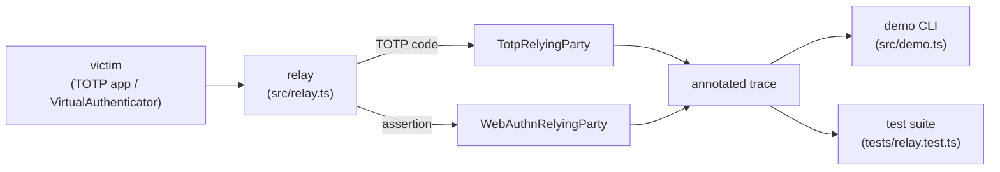

# Architecture

## Context

Organisations roll out MFA and are still phished, because TOTP codes and push
approvals can be relayed by an attacker-in-the-middle in real time. originbound
makes the difference between "MFA" and "phishing-resistant MFA" observable: it
runs the same relay against both factors, inside one process, and records which
protocol field changes the outcome.

## Container view

`src/lab.ts` holds the factors and relying parties. `src/relay.ts` runs the
attack against each and returns a `RelayOutcome` with a trace and the deciding
field. `src/demo.ts` prints the side-by-side output; the tests assert on the
same outcomes. `site/` is a separate, dependency-free browser page that models
the origin-matching rule for interactive exploration.

## Key decisions

- **Everything is in-process.** The "relay" is a function passing values between
  objects in one program. There is no network client, so nothing in the repo can
  be pointed at a third party.
- **The authenticator is virtual.** `VirtualAuthenticator` refuses to sign for an
  origin that does not match the credential's rpId, as a browser-mediated
  authenticator does. Signatures are HMAC-based for simplicity, so the
  verification shape matches WebAuthn but the primitive is symmetric.
- **Origin matching is exact or true subdomain.** `bank.example.evil` is not a
  subdomain of `bank.example`; a naive `endsWith` check would accept it and
  reintroduce phishability. A test pins this.
- **A control run.** `legitimateWebAuthn` runs the same ceremony with no relay,
  so a passing "relay rejected" result cannot be explained by a verifier that
  rejects everything.

## Failure modes

The relying party returns a typed `WebAuthnFailure`: `UNKNOWN_CREDENTIAL`,
`ORIGIN_MISMATCH`, `RPID_MISMATCH`, `CHALLENGE_MISMATCH`, `BAD_SIGNATURE` or
`CLONED_AUTHENTICATOR` (signature counter did not advance). Malformed origins
are rejected rather than throwing.

## Out of scope

- Real attestation verification, CBOR/COSE parsing and browser integration.
- Account recovery flows.
- Any network behaviour; this is a model of a defensive control, not an attack tool.
